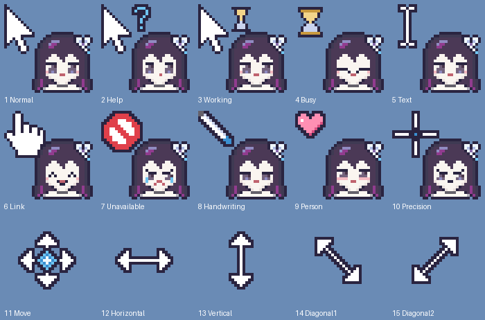

# seele-cursor

Bộ con trỏ chuột Windows phong cách pixel art về **Seele Vollerei (Honkai Impact 3rd)**, bản 死生之律者 tóc dài. Làm để dùng cá nhân, không thương mại.

- 15 con trỏ, bố cục 3 hàng × 5: đầu chibi Seele đặt cạnh mũi tên, hàng cuối là các con trỏ đổi kích thước.
- Đầu ra: `.cur` (tĩnh), `.ani` (động), kèm `install.inf` (chuột phải → Install), cỡ 32 px và 48 px.
- Công cụ: Python + Pillow, vẽ pixel bằng code.

Thiết kế chi tiết nằm ở [docs/DESIGN.md](docs/DESIGN.md).



## Cài đặt (Windows)

1. Mở `dist/Seele-32` (màn hình 100%) hoặc `dist/Seele-48` (màn hình 150% trở lên).
2. Chuột phải `install.inf` → **Install** (Windows 11: **Show more options** → Install).
3. Mở **Mouse Properties → Pointers**, chọn scheme `Seele Pixel 32` (hoặc `48`) rồi bấm **Apply**.

## Dựng lại từ mã nguồn

```sh
pip install Pillow
python3 build.py                          # ghi dist/ và preview/
python3 tools/preview_head.py             # ảnh duyệt biểu cảm: preview/expressions.png
python3 -m unittest discover tests        # kiểm tra cấu trúc .cur/.ani/.inf
```

| File | Nội dung |
|---|---|
| `src/palette.py` | Bảng màu, mỗi màu ứng với một ký tự |
| `src/head.py` | Đầu chibi 22×22 và 9 lớp biểu cảm |
| `src/shapes.py` | Hình con trỏ: mũi tên, I-beam, bàn tay, đồng hồ cát… |
| `src/cursors.py` | Ghép 15 con trỏ, điểm click, khung động |
| `src/curfile.py` | Ghi `.cur` và `.ani` |
| `build.py` | Xuất `dist/`, `install.inf` và ảnh xem trước |

> Fan art phi thương mại. Seele và Honkai Impact 3rd thuộc về miHoYo/HoYoverse. Đây là thiết kế riêng, không sao chép sprite của họa sĩ nào.
